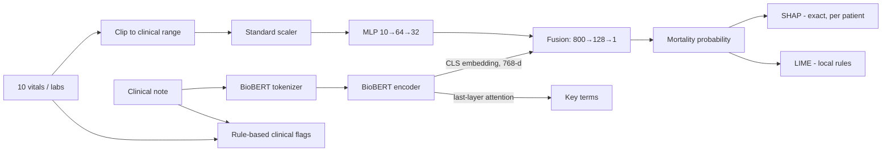

# 🧠 Explainable Multimodal ICU Mortality Prediction

[](https://github.com/kalavalashivaharikowshik/mimic-nlp-explainable-ai/actions/workflows/ci.yml)
[](https://github.com/kalavalashivaharikowshik/mimic-nlp-explainable-ai/actions/workflows/docker.yml)


A full-stack system that estimates in-hospital mortality risk for ICU patients from
**clinical notes (BioBERT)** and **vital signs / lab values**, and explains every
prediction with **attention, SHAP and LIME**.

> ⚠️ **Research prototype.** For education and research only. It is not a medical
> device and has not been validated for clinical decision-making.

---

## ✨ Features

- **Multimodal model**: BioBERT note encoder + MLP for 10 vitals/labs, fused for a single risk score
- **Fast, exact explanations**: BioBERT runs once per request; SHAP (exact, all 1,024 feature coalitions) and LIME reuse the cached note embedding
- **Clinician-readable output**: SHAP and LIME in real units (mmHg, mg/dL), key terms highlighted in the note, transparent rule-based clinical flags with negation handling
- **Web app**: responsive, accessible UI with example patients, inline validation and a live model-status indicator
- **Production-ready API**: FastAPI with typed schemas, interactive docs at `/docs`, proper 422/503 errors, health endpoint, security headers
- **Tested**: 57 automated tests run offline with a tiny stand-in model; CI on every push
- **Deployable**: Dockerfile + one-click automatic deployment to Hugging Face Spaces
- **Reproducible training**: a script that cleans outliers, fits the scaler on the training split only, and reports AUROC / AUPRC / F1

---

## 📸 Screenshots

| Input | Result |
|---|---|
|  |  |

<sub>Screenshots rendered with the test stand-in model, so the numbers shown are only illustrative.</sub>

---

## 🧠 Architecture



| Level | Method | What it tells you |
|---|---|---|
| Text | Last-layer [CLS] attention | Which words the note encoder focused on (a hint, not proof of cause) |
| Structured (exact) | Kernel SHAP, all 2¹⁰ coalitions | How much each vital/lab moved this patient's probability, adding up exactly to the prediction |
| Structured (local) | LIME | Simple threshold rules (e.g. `Creatinine > 1.34`) that approximate the model around this patient |
| Rules | Standard clinical thresholds + negation-aware note keywords | Transparent flags such as *MAP < 65* or *vasopressors mentioned*, clearly separated from model output |

---

## 🚀 Quick start

### 1. Local (Python 3.10 – 3.12)

```bash
git clone https://github.com/kalavalashivaharikowshik/mimic-nlp-explainable-ai.git
cd mimic-nlp-explainable-ai

python -m venv .venv
source .venv/bin/activate          # Windows: .venv\Scripts\activate

# CPU-only PyTorch (smaller download); drop the extra index for GPU builds
pip install -r backend/requirements.txt --extra-index-url https://download.pytorch.org/whl/cpu

uvicorn backend.main:app --reload
```

Open **http://127.0.0.1:8000**. On the first start the trained weights (~430 MB)
and the BioBERT tokenizer are downloaded automatically. The status pill turns green
once the model is ready.

> Run the command from the project root. The UI is served by the backend, so don't
> open `frontend/index.html` directly from disk.

### 2. Docker

```bash
docker build -t mimic-nlp .
docker run -p 7860:7860 mimic-nlp
```

Open **http://localhost:7860**.

### Model weights

The trained model isn't stored in git because of its size. It is downloaded on first start from
[Google Drive](https://drive.google.com/file/d/1g9yuOIIFgxG-xR4_ri6w6LRpv9OBsvQw/view?usp=sharing).
You can also download it yourself and place it at `backend/models/hybrid_model.pth`.
The download is validated, so an interrupted download or a Drive quota page is never loaded.
For faster, more reliable downloads, upload the file to a Hugging Face model repo and set
`MODEL_HF_REPO=your-username/your-model-repo`.

---

## 🔌 API

Interactive documentation: **`/docs`** (Swagger UI) and `/redoc`.

| Method | Path | Description |
|---|---|---|
| `GET` | `/` | Web interface |
| `POST` | `/predict` | Prediction + explanations |
| `GET` | `/health` | `{"status": "ok", "model": "loading" \| "ready" \| "error"}` |
| `GET` | `/api/metadata` | Feature names, units, valid ranges, threshold |

```bash
curl -X POST http://127.0.0.1:8000/predict \
     -H "Content-Type: application/json" \
     -d @data/sample_input.json
```

**Request**: `features` order is `[age, gender (0=male, 1=female), heart_rate, sbp, dbp, mbp, spo2, creatinine, glucose, hemoglobin]`.

```json
{
  "text": "78 y/o admitted with septic shock ... started on norepinephrine ...",
  "features": [78, 1, 122, 84, 46, 58, 87, 3.1, 248, 8.2]
}
```

**Response** (abridged):

```json
{
  "prediction": "HIGH RISK",
  "probability": 0.62,
  "threshold": 0.3,
  "explanation": {
    "important_words": ["norepinephrine", "septic", "intubated"],
    "key_terms": [{"word": "norepinephrine", "score": 1.0}],
    "top_features": [{"name": "creatinine", "label": "Creatinine", "value": 3.1,
                      "contribution": 0.041, "direction": "increases risk"}]
  },
  "clinical_flags": [{"source": "vitals/labs", "message": "Hypotension (mean BP 58 mmHg < 65)"}],
  "shap": {"base_value": 0.18, "values": {"age": 0.02}, "plot": "<base64 PNG>"},
  "lime": {"weights": {"Creatinine > 1.34": 0.05}, "plot": "<base64 PNG>"},
  "note_message": "...",
  "disclaimer": "..."
}
```

Errors: `422` with `{"detail": ["SpO2 must be between 0 and 100 %"]}` for invalid input,
`503` while the model is still loading.

---

## ⚙️ Configuration

All settings are optional environment variables (see [`.env.example`](.env.example)):

| Variable | Default | Purpose |
|---|---|---|
| `MODEL_PATH` | `backend/models/hybrid_model.pth` | Weights location |
| `MODEL_HF_REPO` | – | Download weights from a Hugging Face model repo |
| `MODEL_URL` | Google Drive link | Download URL used when `MODEL_HF_REPO` is not set |
| `MODEL_SHA256` | – | Reject weights that don't match this hash |
| `THRESHOLD` | `0.3` | HIGH/LOW decision threshold on the probability |
| `LOWERCASE_TEXT` | `true` | Lower-case notes (must match training) |
| `MAX_LENGTH` | `256` | Tokens used for prediction **and** explanations |
| `ALLOWED_ORIGINS` | – | CORS origins, only needed if the UI is hosted elsewhere |
| `PORT` | `7860` (Docker) | Server port |

---

## ☁️ Deployment (free, Hugging Face Spaces)

The free CPU tier of Hugging Face Spaces (2 vCPU, 16 GB RAM) runs the full BioBERT
model. Deployment is automated by [`.github/workflows/deploy.yml`](.github/workflows/deploy.yml):

1. Create a free account at [huggingface.co](https://huggingface.co) and a **write** access token
   (*Settings → Access Tokens*).
2. In this GitHub repo go to **Settings → Secrets and variables → Actions**:
   - **Secrets** tab → *New repository secret* → `HF_TOKEN` = your token
   - **Variables** tab → *New repository variable* → `HF_SPACE` = `your-hf-username/icu-mortality-xai`
3. Push to `main` (or run the workflow manually under **Actions → Deploy to Hugging Face Spaces**).

The workflow creates the Space and publishes the app at
`https://huggingface.co/spaces/<your-hf-username>/icu-mortality-xai`. Each later push to
`main` redeploys automatically. To deploy from your own machine instead:

```bash
pip install huggingface_hub
HF_TOKEN=hf_xxx HF_SPACE=your-hf-username/icu-mortality-xai python deploy/push_to_space.py
```

The same Docker image also runs on Render, Railway, Fly.io or any VM with ≥ 2 GB RAM.

---

## 🏋️ Training / retraining

`training/train.py` builds a model the web app can serve directly. You need your own
MIMIC extract (PhysioNet credentialed access). Use one row per ICU stay with columns
`text, age, gender, heart_rate, sbp, dbp, mbp, spo2, creatinine, glucose, hemoglobin, label`.

```bash
pip install -r training/requirements.txt --extra-index-url https://download.pytorch.org/whl/cpu
python -m training.train --data training/data/cohort.csv --epochs 3
cp training/outputs/hybrid_model.pth backend/models/
cp training/outputs/scaler.json      backend/scaler/scaler.json
# then serve with the threshold printed at the end of training, e.g. THRESHOLD=0.27
```

What the training script does:

- treats impossible values and charting error codes (e.g. SpO2 > 100, HR = 999999) as missing
- clips to plausible clinical ranges, imputes with training medians
- uses a stratified train/val/test split and fits the scaler on **train only**
- uses a class-weighted loss for the rare outcome and selects the model on validation AUPRC
- picks the decision threshold on validation, then reports test AUROC, AUPRC, precision, recall, F1 and accuracy to `metrics.json`

---

## 📊 Model card

| | |
|---|---|
| Task | Binary in-hospital mortality prediction for ICU stays |
| Data | MIMIC (de-identified, PhysioNet credentialed access) |
| Text encoder | `dmis-lab/biobert-base-cased-v1.1` (fine-tuned) |
| Structured inputs | Age, gender, HR, SBP, DBP, MBP, SpO2, creatinine, glucose, hemoglobin |
| Reported metrics (original run) | Accuracy ≈ 0.80 · F1 ≈ 0.47 · AUROC ≈ 0.87 |

**Known limitations**

- The reported metrics come from the original training run, whose evaluation code isn't
  in this repository. Retrain with `training/train.py` to get reproducible numbers.
  Mortality is imbalanced (~10–15 %), so AUROC/AUPRC/F1 matter more than accuracy.
- **The published weights barely use heart rate, blood pressure and SpO2.** Their scaler was
  fitted on uncleaned data (SpO2 mean 102.7 %, MBP std 1,722 mmHg), which squashes these
  vitals to almost the same value for every patient. Retraining with `training/train.py`
  fixes this.
- Attention weights are a hint about what the encoder focused on, not a causal explanation.
- SHAP and LIME explain the structured features with the note held fixed.
- Trained on a single US hospital system; performance elsewhere is unknown.

---

## 🔐 Data use & privacy

- No patient data is stored or logged by the app.
- SHAP/LIME use a **synthetic** reference cohort ([`backend/background.py`](backend/background.py)).
  No MIMIC records are included in this repository.
- MIMIC data and models trained on it are subject to the
  [PhysioNet Credentialed Health Data Use Agreement](https://physionet.org/content/mimiciv/view-dua/).
  Don't commit MIMIC data, and check the DUA before sharing trained weights publicly.

---

## 🧪 Development

```bash
pip install -r requirements-dev.txt --extra-index-url https://download.pytorch.org/whl/cpu
pytest            # 57 tests, offline, ~5 s
ruff check . && ruff format --check .
```

```
mimic-nlp-explainable-ai/
├── backend/
│   ├── main.py            # FastAPI app: UI, /predict, /health, /api/metadata
│   ├── predict.py         # MortalityPredictor: one BioBERT pass → prediction + explanations
│   ├── model.py           # HybridModel (BioBERT + MLP fusion)
│   ├── load_model.py      # safe, validated weight download and loading
│   ├── explain.py         # SHAP / LIME on the cached note embedding
│   ├── nlp.py             # attention key terms
│   ├── clinical_flags.py  # rule-based, negation-aware flags
│   ├── plots.py           # thread-safe charts
│   ├── background.py      # synthetic reference cohort
│   ├── scaler.py          # portable JSON standard scaler
│   ├── schemas.py         # request/response models
│   ├── utils.py           # validation and text cleaning
│   ├── config.py          # paths, features, settings
│   └── scaler/scaler.json
├── frontend/              # index.html, style.css, script.js
├── training/              # preprocess.py, train.py
├── tests/                 # pytest suite with a tiny stand-in model
├── deploy/                # Hugging Face Spaces deploy script
├── data/                  # sample API requests (synthetic)
├── Dockerfile
└── .github/workflows/     # CI, Docker build, deployment
```

---

## 🛠️ Tech stack

**Backend** FastAPI · PyTorch · Hugging Face Transformers (BioBERT) · NumPy · scikit-learn
**Explainability** SHAP · LIME · attention
**Frontend** HTML · CSS · vanilla JavaScript
**Ops** Docker · GitHub Actions · Hugging Face Spaces

## 📌 Future work

- Temporal modelling of ICU time series
- Calibration analysis and external validation
- Integrated-gradients explanations for the note text

## 👨‍💻 Author

**kalavalashivaharikowshik** · [GitHub](https://github.com/kalavalashivaharikowshik)

## 📄 License

Source code: [MIT](LICENSE). MIMIC data and derived models: PhysioNet Credentialed Health Data Use Agreement.
