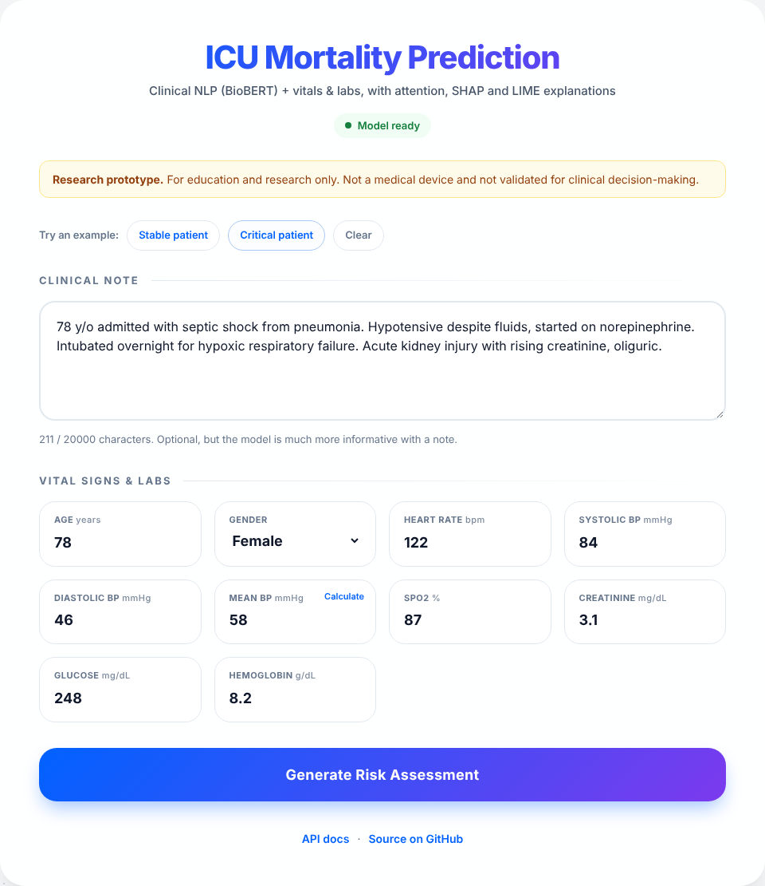
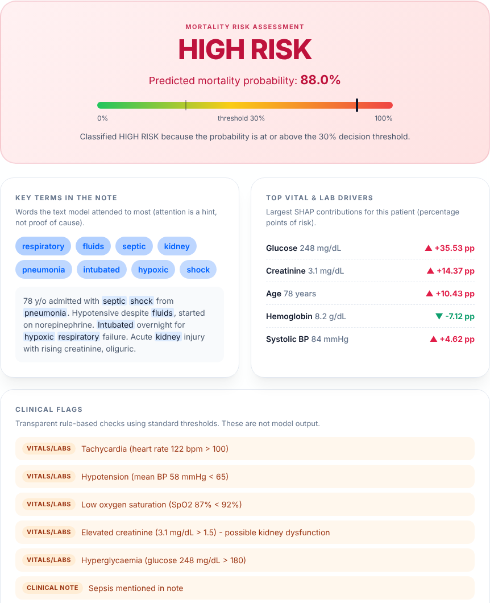
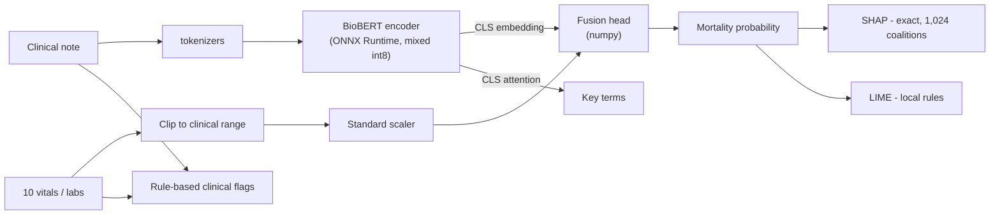

# 🧠 Explainable Multimodal ICU Mortality Prediction

[](https://github.com/kalavalashivaharikowshik/mimic-nlp-explainable-ai/actions/workflows/ci.yml)
[](https://github.com/kalavalashivaharikowshik/mimic-nlp-explainable-ai/actions/workflows/docker.yml)


A full-stack system that estimates in-hospital mortality risk for ICU patients from
**clinical notes (BioBERT)** and **vital signs / lab values**, and explains every
prediction with **attention, exact SHAP and LIME**. Inference runs on **ONNX Runtime**
with a mixed-precision int8 BioBERT, so the whole app fits in **512 MB of RAM** (342 MB
peak) and can be hosted for free.

> ⚠️ **Research prototype.** For education and research only. It is not a medical
> device and has not been validated for clinical decision-making.

[](https://render.com/deploy?repo=https://github.com/kalavalashivaharikowshik/mimic-nlp-explainable-ai)

---

## ✨ Features

- **Multimodal model**: BioBERT note encoder + MLP for 10 vitals/labs, fused for a single risk score
- **Lightweight inference**: ONNX Runtime + `tokenizers` + numpy, with no PyTorch on the server. The mixed-precision int8 encoder is 2.2× smaller (194 MB). Its accuracy is measured on every export (mean probability change 0.009), and predictions close to the threshold are flagged as borderline
- **Exact, fast explanations**: SHAP computed exactly from all 1,024 feature coalitions (identical to `shap.KernelExplainer`, 60× faster) and LIME, both in pure numpy, reusing one cached note embedding
- **Clinician-readable output**: SHAP and LIME in real units (mmHg, mg/dL), key terms highlighted in the note, transparent rule-based clinical flags with negation handling
- **Web app**: responsive, accessible UI with example patients, inline validation, live model status, charts drawn in the browser
- **Production-ready API**: FastAPI with typed schemas, docs at `/docs`, proper 422/503 errors, health endpoint, security headers
- **Tested**: 62 automated tests, including ONNX-vs-PyTorch parity; CI on every push, with a Docker test at a 512 MB memory limit
- **Free deployment**: one-click Render blueprint; the model is published as a GitHub release by a workflow

---

## 📸 Screenshots

| Input | Result |
|---|---|
|  |  |

<sub>Real output of the published model (mixed-precision ONNX) for the built-in "Critical patient" example (synthetic data).</sub>

---

## 🧠 Architecture



BioBERT runs **once** per request. SHAP and LIME then re-evaluate only the tiny fusion
head (about 7k multiply-adds per sample) about 53,000 times, which takes a few milliseconds.

| Level | Method | What it tells you |
|---|---|---|
| Text | Last-layer [CLS] attention | Which words the note encoder focused on (a hint, not proof of cause) |
| Structured (exact) | Shapley values over all 2¹⁰ coalitions | How much each vital/lab moved this patient's probability, adding up exactly to the prediction |
| Structured (local) | LIME (weighted ridge on quartile rules) | Simple threshold rules (e.g. `Creatinine > 1.34`) that approximate the model around this patient |
| Rules | Standard clinical thresholds + negation-aware note keywords | Transparent flags such as *MAP < 65* or *vasopressors mentioned*, clearly separated from model output |

### Resource use (real model, 256-token note, measured)

| | PyTorch version | ONNX Runtime version |
|---|---|---|
| Server dependencies | ~2.5 GB | ~190 MB |
| Model file | 434 MB | 194 MB |
| Peak RAM (whole server) | ~2 GB | **342 MB** |
| Latency per request (1 CPU core) | minutes (old SHAP/LIME) | **~0.3 s** |

---

## 🚀 Quick start

### 1. Local (Python 3.10 – 3.12)

```bash
git clone https://github.com/kalavalashivaharikowshik/mimic-nlp-explainable-ai.git
cd mimic-nlp-explainable-ai

python -m venv .venv
source .venv/bin/activate          # Windows: .venv\Scripts\activate

pip install -r backend/requirements.txt     # lean: no PyTorch
uvicorn backend.main:app --reload
```

Open **http://127.0.0.1:8000**. On first start the ONNX model (~195 MB) is downloaded
from the [`model-v1` release](https://github.com/kalavalashivaharikowshik/mimic-nlp-explainable-ai/releases/tag/model-v1)
and verified against its SHA-256 checksums. The status pill turns green once it is ready.

> Run the command from the project root. The UI is served by the backend, so don't
> open `frontend/index.html` directly from disk.

### 2. Docker

```bash
docker build -t mimic-nlp .
docker run -p 8000:8000 mimic-nlp
```

---

## ☁️ Free deployment (Render)

Render's free plan (512 MB RAM, no credit card) runs the full app. The plan sleeps after
15 minutes without traffic and takes about a minute to wake up.

1. **Publish the model once.** On GitHub go to **Actions → Export ONNX model → Run workflow**.
   This downloads the trained weights, converts them to ONNX on GitHub's servers, checks them
   against PyTorch, and publishes the release `model-v1`. It takes about 10 minutes.
2. **Deploy.** Click **Deploy to Render** above, or in the [Render dashboard](https://dashboard.render.com)
   choose **New → Blueprint** and select this repository. Render reads [`render.yaml`](render.yaml),
   builds the Docker image with the model baked in, and gives you a public
   `https://icu-mortality-xai.onrender.com`-style URL.
3. That's it. Every push to `main` redeploys automatically.

The same image runs on any Docker host (Koyeb, Railway, Fly.io, a VM) with ≥ 512 MB RAM.

---

## 🔌 API

Interactive documentation: **`/docs`** (Swagger UI) and `/redoc`.

| Method | Path | Description |
|---|---|---|
| `GET` | `/` | Web interface |
| `POST` | `/predict` | Prediction + explanations |
| `GET` | `/health` | `{"status": "ok", "model": "loading" \| "ready" \| "error"}` |
| `GET` | `/api/metadata` | Feature names, units, valid ranges, threshold |

```bash
curl -X POST http://127.0.0.1:8000/predict \
     -H "Content-Type: application/json" \
     -d @data/sample_input.json
```

**Request**: `features` order is `[age, gender (0=male, 1=female), heart_rate, sbp, dbp, mbp, spo2, creatinine, glucose, hemoglobin]`.

```json
{
  "text": "78 y/o admitted with septic shock ... started on norepinephrine ...",
  "features": [78, 1, 122, 84, 46, 58, 87, 3.1, 248, 8.2]
}
```

**Response** (abridged):

```json
{
  "prediction": "HIGH RISK",
  "probability": 0.62,
  "threshold": 0.3,
  "explanation": {
    "important_words": ["norepinephrine", "septic", "intubated"],
    "key_terms": [{"word": "norepinephrine", "score": 1.0}],
    "top_features": [{"name": "creatinine", "label": "Creatinine", "value": 3.1,
                      "contribution": 0.041, "direction": "increases risk"}]
  },
  "clinical_flags": [{"source": "vitals/labs", "message": "Hypotension (mean BP 58 mmHg < 65)"}],
  "shap": {"base_value": 0.18, "values": {"age": 0.02, "creatinine": 0.041}},
  "lime": {"weights": {"Creatinine > 1.34": 0.05}, "fit_r2": 0.71},
  "note_message": "...",
  "disclaimer": "..."
}
```

`base_value + sum(shap.values) == probability` exactly. Errors: `422` with
`{"detail": ["SpO2 must be between 0 and 100 %"]}` for invalid input, `503` while the model loads.

---

## ⚙️ Configuration

All settings are optional environment variables (see [`.env.example`](.env.example)):

| Variable | Default | Purpose |
|---|---|---|
| `MODEL_BASE_URL` | `model-v1` release URL | Where to download the ONNX model from |
| `ONNX_DIR` | `backend/models/onnx` | Local model folder |
| `ONNX_ENCODER` | manifest default (mixed int8) | `encoder.onnx` for float32 (needs ~700 MB RAM) |
| `ORT_THREADS` | `0` (auto) | ONNX Runtime CPU threads |
| `ORT_LOW_MEMORY` | `true` | ~100 MB less RAM for ~25 % slower inference |
| `THRESHOLD` | `0.3` | HIGH/LOW decision threshold on the probability |
| `BORDERLINE_MARGIN` | `0.05` | Flag predictions this close to the threshold |
| `ALLOWED_ORIGINS` | – | CORS origins, only needed if the UI is hosted elsewhere |
| `PORT` | `8000` (Docker) | Server port |

---

## 🏋️ Training and export

Training and export need PyTorch: `pip install -r requirements-ml.txt --extra-index-url https://download.pytorch.org/whl/cpu`.

**Train** with your own MIMIC extract (PhysioNet credentialed access). Use one row per ICU stay
with columns `text, age, gender, heart_rate, sbp, dbp, mbp, spo2, creatinine, glucose, hemoglobin, label`.

```bash
pip install -r training/requirements.txt --extra-index-url https://download.pytorch.org/whl/cpu
python -m training.train --data training/data/cohort.csv --epochs 3
cp training/outputs/scaler.json backend/scaler/scaler.json
```

The training script:

- treats impossible values and charting error codes (e.g. SpO2 > 100, HR = 999999) as missing
- clips to plausible clinical ranges, imputes with training medians
- uses a stratified train/val/test split and fits the scaler on **train only**
- uses a class-weighted loss and selects the model on validation AUPRC
- picks the threshold on validation, then reports test AUROC, AUPRC, precision, recall, F1 and accuracy to `metrics.json`

**Export** to ONNX, locally or with the *Export ONNX model* workflow (give it the new `.pth` URL):

```bash
python -m tools.export_onnx --weights training/outputs/hybrid_model.pth --out dist/onnx
```

This writes `encoder.onnx`, `encoder.int8.onnx`, `head.npz`, `tokenizer.json` and
`manifest.json` (with SHA-256 checksums). The export fails if the float32 graph differs
from PyTorch, or if the int8 encoder changes probabilities too much on 120 synthetic notes.

**Why mixed precision?** On the real fine-tuned model, plain int8 quantization changed
probabilities by up to 0.18 (mean 0.021). BERT's feed-forward output projections see large
activation outliers, so the export keeps those 12 layers in float32:

| Encoder | Size | Max change | Mean change | Peak RAM |
|---|---|---|---|---|
| float32 | 431 MB | 0 | 0 | 642 MB |
| plain int8 | 109 MB | 0.177 | 0.021 | 197 MB |
| **mixed int8 (used)** | **194 MB** | **0.055** | **0.009** | **306 MB** |

---

## 📊 Model card

| | |
|---|---|
| Task | Binary in-hospital mortality prediction for ICU stays |
| Data | MIMIC (de-identified, PhysioNet credentialed access) |
| Text encoder | `dmis-lab/biobert-base-cased-v1.1` (fine-tuned), served as mixed-precision int8 ONNX |
| Structured inputs | Age, gender, HR, SBP, DBP, MBP, SpO2, creatinine, glucose, hemoglobin |
| Reported metrics (original run) | Accuracy ≈ 0.80 · F1 ≈ 0.47 · AUROC ≈ 0.87 |

**Known limitations**

- The reported metrics come from the original training run, whose evaluation code isn't
  in this repository. Retrain with `training/train.py` to get reproducible numbers.
  Mortality is imbalanced (~10–15 %), so AUROC/AUPRC/F1 matter more than accuracy.
- **The published weights barely use heart rate, blood pressure and SpO2.** Their scaler was
  fitted on uncleaned data (SpO2 mean 102.7 %, MBP std 1,722 mmHg), which squashes these
  vitals to almost the same value for every patient. Retraining fixes this.
- Quantization changes probabilities by 0.009 on average (max 0.055) compared with float32.
  Labels only changed for patients within 0.003 of the threshold, and the UI marks predictions
  within 5 percentage points of the threshold as borderline.
- Attention weights are a hint about what the encoder focused on, not a causal explanation.
- SHAP and LIME explain the structured features with the note held fixed.
- Trained on a single US hospital system; performance elsewhere is unknown.

---

## 🔐 Data use & privacy

- No patient data is stored or logged by the app.
- SHAP/LIME use a **synthetic** reference cohort ([`backend/background.py`](backend/background.py)).
  No MIMIC records are included in this repository.
- MIMIC data and models trained on it are subject to the
  [PhysioNet Credentialed Health Data Use Agreement](https://physionet.org/content/mimiciv/view-dua/).
  Don't commit MIMIC data, and check the DUA before sharing trained weights publicly.

---

## 🧪 Development

```bash
pip install -r requirements-dev.txt --extra-index-url https://download.pytorch.org/whl/cpu
pytest            # 62 tests, offline, ~5 s
ruff check . && ruff format --check .
```

Tests use a tiny 2-layer BERT with the real architecture, export it with the real
`tools/export_onnx.py`, and run the production ONNX code path, so no download is needed.

```
mimic-nlp-explainable-ai/
├── backend/               # web server (ONNX Runtime, no PyTorch)
│   ├── main.py            # FastAPI app: UI, /predict, /health, /api/metadata
│   ├── predict.py         # MortalityPredictor: one encoder pass → prediction + explanations
│   ├── artifacts.py       # download + verify + load the ONNX model
│   ├── fusion.py          # fusion head in numpy
│   ├── explain.py         # exact SHAP and LIME in numpy
│   ├── nlp.py             # attention key terms
│   ├── clinical_flags.py  # rule-based, negation-aware flags
│   ├── background.py      # synthetic reference cohort
│   ├── scaler.py          # portable JSON standard scaler
│   ├── downloads.py       # validated, atomic downloads
│   ├── schemas.py, utils.py, config.py
│   ├── model.py           # PyTorch HybridModel (training / export only)
│   └── scaler/scaler.json
├── frontend/              # index.html, style.css, script.js
├── tools/export_onnx.py   # PyTorch → ONNX (+ int8) with parity check
├── training/              # preprocess.py, train.py
├── tests/                 # pytest suite
├── data/                  # sample API requests (synthetic)
├── Dockerfile, render.yaml
└── .github/workflows/     # CI, Docker (incl. 512 MB test), ONNX export & release
```

---

## 🛠️ Tech stack

**Serving** FastAPI · ONNX Runtime · Hugging Face `tokenizers` · NumPy
**Training / export** PyTorch · Transformers (BioBERT) · ONNX · scikit-learn · pandas
**Explainability** exact Shapley values · LIME · attention
**Frontend** HTML · CSS · vanilla JavaScript
**Ops** Docker · GitHub Actions · Render

## 📌 Future work

- Temporal modelling of ICU time series
- Calibration analysis and external validation
- Integrated-gradients explanations for the note text

## 👨‍💻 Author

**kalavalashivaharikowshik** · [GitHub](https://github.com/kalavalashivaharikowshik)

## 📄 License

Source code: [MIT](LICENSE). MIMIC data and derived models: PhysioNet Credentialed Health Data Use Agreement.
